# Utilitly PDF engines

Six small JavaScript packages for everyday PDF jobs: merge, split and rotate, and delete, reorder or duplicate pages. Each one takes a PDF as bytes and returns new bytes, so the same code runs in Node.js and in the browser.

They're the engines from the free PDF tools on [utilitly.com](https://utilitly.com), packaged for your own code.

<p align="center">
  <picture>
    <source media="(prefers-color-scheme: dark)" srcset="./assets/network-dark.svg">
    
  </picture>
</p>

Nothing here talks to a server. The PDF never leaves the process that handles it, which you can check in DevTools: the Network panel stays empty.

## Packages

| Package | What it does |
| --- | --- |
| [`@utilitly/pdf-merge`](./packages/pdf-merge) | Merge PDFs into one, in the order given. |
| [`@utilitly/pdf-split`](./packages/pdf-split) | Split by ranges like `1-3, 5, 8-end`, or pull selected pages into a new PDF. |
| [`@utilitly/pdf-rotate`](./packages/pdf-rotate) | Rotate every page or chosen pages by multiples of 90 degrees. |
| [`@utilitly/pdf-delete-pages`](./packages/pdf-delete-pages) | Remove pages by ranges like `2, 5-end`. |
| [`@utilitly/pdf-reorder-pages`](./packages/pdf-reorder-pages) | Put every page in a new order, e.g. `[3, 1, 2]`. |
| [`@utilitly/pdf-duplicate-pages`](./packages/pdf-duplicate-pages) | Copy pages, right after the original or at the end, without repeating their images. |

## Development

Needs Node.js 22.18+ or 24.11+ (`.nvmrc` pins 24).

```sh
npm install
npm run check        # everything below except the smoke install
npm run smoke        # install the packed packages into a fresh project and run them
npm run playground   # try every package on your own files at http://localhost:5173
```

`npm run check` runs, in order:

1. `leak-check`: fails on API keys and other secrets, home-folder paths and
   `.env` files, plus the maintainer's private rules when they're on the
   machine (see `scripts/leak-check.mjs`)
2. `typecheck`: engine code is checked with no DOM or Node types, so it can't
   depend on either runtime
3. `build`: ESM and CommonJS output with type definitions, via tsdown
4. `typecheck:playground`: the playground against the packages' built types
5. `test`: Vitest
6. `lint:packages`: publint and Are the Types Wrong on every package

The playground loads the built packages, so it runs exactly what npm would
ship. Nothing in it leaves your machine.

The animated images in each README come from `scripts/readme-art.mjs`. Edit
that script and run `node scripts/readme-art.mjs` rather than editing the SVGs;
a test fails if they drift apart.

## License

MIT
