<p align="center">
  <picture>
    <source media="(prefers-color-scheme: dark)" srcset="./assets/hero-dark.svg">
    
  </picture>
</p>

# @utilitly/pdf-delete-pages

Delete pages from a PDF in JavaScript. Name them the way you'd say them, like `2, 5-end`, and get back a PDF without them, in Node.js or the browser. Nothing is uploaded.

It's the engine from the [Delete PDF Pages tool on utilitly.com](https://utilitly.com/delete-pdf-pages), with one improvement: the pages you keep are copied into the new file in a single pass, so an image or font they share is stored once instead of once per page.

## Install

```sh
npm install @utilitly/pdf-delete-pages
```

One dependency, pdf-lib. ESM, CommonJS and TypeScript types are built in.

## Delete pages in 30 seconds

In Node.js, dropping a blank page and an appendix:

```js
import { readFile, writeFile } from 'node:fs/promises'
import { deletePages } from '@utilitly/pdf-delete-pages'

const trimmed = await deletePages(await readFile('scan.pdf'), '2, 5-end')
await writeFile('scan-trimmed.pdf', trimmed)
```

In the browser, removing a cover page:

```js
import { deletePages } from '@utilitly/pdf-delete-pages'

// file: a File from <input type="file" accept="application/pdf">
const cleaned = await deletePages(await file.arrayBuffer(), '1')
const url = URL.createObjectURL(new Blob([cleaned], { type: 'application/pdf' }))
```

## API

### `deletePages(pdf, pages)`

Returns `Promise<Uint8Array>`: a new PDF with every page except the ones you named, in their original order.

| Parameter | Type | |
| --- | --- | --- |
| `pdf` | `Uint8Array \| ArrayBuffer` | The PDF. A Node.js `Buffer` works as-is. |
| `pages` | `string` | The pages to remove: `3`, `2-5`, `8-end`, `end`, or several of those separated by commas. |

Spaces don't matter. A range that runs past the last page stops there, parts that aren't page numbers are ignored, and a backwards range such as `5-3` matches nothing.

### Errors

Problems come back as a `PdfError` with a `code`:

| `code` | When |
| --- | --- |
| `NO_PAGES` | `pages` matches no page, e.g. `'9'` on a 3-page file. |
| `INVALID_OPTIONS` | `pages` would remove every page (a PDF needs at least one), or it isn't a string. |
| `NOT_A_PDF` | The bytes aren't a readable PDF. |
| `ENCRYPTED` | The PDF is password-protected; remove the password before deleting pages. |
| `INVALID_INPUT` | `pdf` isn't a `Uint8Array` or `ArrayBuffer`. |

## Why nothing is uploaded

<p align="center">
  <picture>
    <source media="(prefers-color-scheme: dark)" srcset="./assets/network-dark.svg">
    
  </picture>
</p>

People delete pages because something on them shouldn't be shared: a signature page, an internal appendix, a page of account numbers. Sending the whole document to a server to do that defeats the point. This package does the work with pdf-lib in your own process, and the browser's Network panel stays empty while it runs.

## Good to know

- The new file only holds what the remaining pages use, so images and fonts that only the deleted pages needed are gone from it too.
- Every page you keep keeps its size and its rotation.
- Bookmarks, document properties such as title and author, and the interactivity of form fields don't carry over: the result is a fresh PDF, with pdf-lib as its producer. Form fields stay visible on the page but no longer work as fields.

## License

MIT. Built on [pdf-lib](https://github.com/Hopding/pdf-lib) (MIT).

Other Utilitly PDF engines: [merge](https://www.npmjs.com/package/@utilitly/pdf-merge) · [split](https://www.npmjs.com/package/@utilitly/pdf-split) · [rotate](https://www.npmjs.com/package/@utilitly/pdf-rotate) · [reorder pages](https://www.npmjs.com/package/@utilitly/pdf-reorder-pages) · [duplicate pages](https://www.npmjs.com/package/@utilitly/pdf-duplicate-pages)
