<p align="center">
  <picture>
    <source media="(prefers-color-scheme: dark)" srcset="./assets/hero-dark.svg">
    
  </picture>
</p>

# @utilitly/pdf-duplicate-pages

Duplicate PDF pages in JavaScript without the file ballooning. Choose the pages, how many copies, and whether the copies go right after the original or at the end. Runs in Node.js and the browser, with no upload.

This is the engine from the [Duplicate PDF Page tool on utilitly.com](https://utilitly.com/duplicate-pdf-page). Each copy is its own page that points at the original's content, images and fonts, so a photo on the page is stored once however many copies you make.

## Install

```sh
npm install @utilitly/pdf-duplicate-pages
```

Published as ESM and CommonJS, typed for TypeScript, with pdf-lib as the one dependency.

## Duplicate pages in 30 seconds

In Node.js, three extra copies of a sign-up sheet:

```js
import { readFile, writeFile } from 'node:fs/promises'
import { duplicatePages } from '@utilitly/pdf-duplicate-pages'

const sheets = await duplicatePages(await readFile('form.pdf'), '2', { copies: 3 })
await writeFile('form-with-copies.pdf', sheets)
```

In the browser, repeating two pages at the end of the document:

```js
import { duplicatePages } from '@utilitly/pdf-duplicate-pages'

// file: a File from <input type="file" accept="application/pdf">
const extended = await duplicatePages(await file.arrayBuffer(), '1, 3', { placement: 'end' })
```

## API

### `duplicatePages(pdf, pages, options?)`

Returns `Promise<Uint8Array>`, the PDF with the copies added. `pdf` is a `Uint8Array` or `ArrayBuffer` (Node.js `Buffer` included), and `pages` picks the pages to copy using the same syntax as everywhere else in these packages: `2`, `1-3`, `4-end`, comma-separated.

| Option | Default | |
| --- | --- | --- |
| `copies` | `1` | Extra copies of each selected page. A whole number, 1 or more. |
| `placement` | `'after'` | `'after'` puts the copies straight after their page. `'end'` adds them all at the end, in page order. |
| `onProgress` | | `(done, total) => void \| Promise<void>`, after each page of the output is written. It's awaited, and `total` is the final page count. |

On a 3-page PDF:

| Call | Pages in the result |
| --- | --- |
| `duplicatePages(pdf, '2')` | 1, 2, 2, 3 |
| `duplicatePages(pdf, '2', { copies: 2 })` | 1, 2, 2, 2, 3 |
| `duplicatePages(pdf, '1, 3', { placement: 'end' })` | 1, 2, 3, 1, 3 |

### Errors

A `PdfError`, with one of these codes:

| `code` | When |
| --- | --- |
| `NO_PAGES` | `pages` matches nothing in the document. |
| `INVALID_OPTIONS` | `copies` isn't a whole number from 1 up, `placement` isn't `'after'` or `'end'`, or `pages` isn't a string. |
| `NOT_A_PDF` | The file can't be parsed as a PDF. |
| `ENCRYPTED` | It's password-protected. Remove the password, then duplicate. |

## Why nothing is uploaded

<p align="center">
  <picture>
    <source media="(prefers-color-scheme: dark)" srcset="./assets/network-dark.svg">
    
  </picture>
</p>

Forms, timesheets and handouts get duplicated, and they're full of names and numbers. The copying happens in memory, in whichever tab or Node.js process calls `duplicatePages`, and nothing touches the network on the way.

## Good to know

- Copies are real pages. Each one has its own entry in the document's page list, so viewers, printers and other tools count and handle them like any other page.
- Bookmarks, document properties and live form fields don't come along: the output is a new PDF produced by pdf-lib, and field boxes show up as plain content.

## License

MIT. Built on [pdf-lib](https://github.com/Hopding/pdf-lib) (MIT as well).

The other Utilitly PDF engines: [merge](https://www.npmjs.com/package/@utilitly/pdf-merge) · [split](https://www.npmjs.com/package/@utilitly/pdf-split) · [rotate](https://www.npmjs.com/package/@utilitly/pdf-rotate) · [delete pages](https://www.npmjs.com/package/@utilitly/pdf-delete-pages) · [reorder pages](https://www.npmjs.com/package/@utilitly/pdf-reorder-pages)
