<p align="center">
  <picture>
    <source media="(prefers-color-scheme: dark)" srcset="./assets/hero-dark.svg">
    
  </picture>
</p>

# @utilitly/pdf-merge

Merge PDF files in JavaScript with one function call. It runs in Node.js and in the browser, and the files never leave the machine that runs it.

Hand `mergePdfs` an array of PDFs and you get back a single PDF with every page, in the order you passed them. There's no server to call, no API key and no upload step. It's the merge logic from the [Merge PDF tool on utilitly.com](https://utilitly.com/merge-pdf), packaged for your own code.

## Install

```sh
npm install @utilitly/pdf-merge
```

Ships ESM and CommonJS builds with TypeScript types. Its one dependency is [pdf-lib](https://github.com/Hopding/pdf-lib).

## Merge PDFs in 30 seconds

In Node.js:

```js
import { readFile, writeFile } from 'node:fs/promises'
import { mergePdfs } from '@utilitly/pdf-merge'

const book = await mergePdfs([
  await readFile('cover.pdf'),
  await readFile('chapter-1.pdf'),
  await readFile('chapter-2.pdf'),
])
await writeFile('book.pdf', book)
```

In the browser, straight from a file input:

```js
import { mergePdfs } from '@utilitly/pdf-merge'

// files: the FileList from <input type="file" accept="application/pdf" multiple>
const merged = await mergePdfs(await Promise.all([...files].map(file => file.arrayBuffer())))
const url = URL.createObjectURL(new Blob([merged], { type: 'application/pdf' }))
```

## API

### `mergePdfs(pdfs, options?)`

Returns `Promise<Uint8Array>`: the bytes of the merged PDF.

| Parameter | Type | |
| --- | --- | --- |
| `pdfs` | `Array<Uint8Array \| ArrayBuffer>` | At least one PDF. A Node.js `Buffer` works as-is. |
| `options.onProgress` | `(done, total) => void \| Promise<void>` | Called after each file is added. If it returns a promise, merging waits for it, so a UI can repaint between files. |

```js
await mergePdfs(pdfs, {
  onProgress: (done, total) => console.log(`${done} of ${total} files`),
})
```

### Errors

Every failure is a `PdfError` with a `code` you can switch on:

| `code` | When |
| --- | --- |
| `INVALID_OPTIONS` | `pdfs` isn't an array, or it's empty. |
| `INVALID_INPUT` | One of the items isn't a `Uint8Array` or `ArrayBuffer`. |
| `NOT_A_PDF` | One of the files can't be parsed as a PDF. The message names it: `File 2 could not be read as a PDF.` |
| `ENCRYPTED` | One of the files is password-protected. Remove its password first. |

## Why nothing is uploaded

<p align="center">
  <picture>
    <source media="(prefers-color-scheme: dark)" srcset="./assets/network-dark.svg">
    
  </picture>
</p>

Merging happens in the same JavaScript process that calls `mergePdfs`. This package and pdf-lib contain no network code, so the PDFs stay in memory where you put them. Open DevTools while it runs and the Network panel has nothing to show. That makes it a fit for contracts, medical records and anything else you shouldn't hand to a third-party API.

## Good to know

- Pages keep their own size and rotation, so a Letter page and a sideways A4 page sit side by side in the output.
- Each file's pages are copied in one pass, so an image or font shared by several pages of a file is embedded once, not once per page.
- Bookmarks (the document outline) aren't carried over, and neither are document properties such as title and author. The merged file starts fresh, with pdf-lib as its producer.
- Form fields stop being interactive. The boxes stay visible on the page, but the merged PDF no longer lists them as fields.

## License

MIT. Built on [pdf-lib](https://github.com/Hopding/pdf-lib), also MIT.

Other Utilitly PDF engines: [split](https://www.npmjs.com/package/@utilitly/pdf-split) · [rotate](https://www.npmjs.com/package/@utilitly/pdf-rotate) · [delete pages](https://www.npmjs.com/package/@utilitly/pdf-delete-pages) · [reorder pages](https://www.npmjs.com/package/@utilitly/pdf-reorder-pages) · [duplicate pages](https://www.npmjs.com/package/@utilitly/pdf-duplicate-pages)
