<p align="center">
  <picture>
    <source media="(prefers-color-scheme: dark)" srcset="./assets/hero-dark.svg">
    
  </picture>
</p>

# @utilitly/pdf-reorder-pages

Reorder PDF pages in JavaScript: pass the page numbers in the order you want, get back a PDF in that order. Works in Node.js and in the browser, and nothing is uploaded.

On the [Reorder PDF Pages tool on utilitly.com](https://utilitly.com/reorder-pdf-pages) you drag thumbnails around. This package is the same job for code: hand over the new order as an array, and every page is checked off before a single byte is written.

## Install

```sh
npm install @utilitly/pdf-reorder-pages
```

Comes as ESM and CommonJS with TypeScript types. Its single dependency is pdf-lib.

## Reorder pages in 30 seconds

In Node.js, moving a summary from the back of a deck to the front:

```js
import { readFile, writeFile } from 'node:fs/promises'
import { reorderPages } from '@utilitly/pdf-reorder-pages'

const deck = await reorderPages(await readFile('deck.pdf'), [6, 1, 2, 3, 4, 5])
await writeFile('deck-summary-first.pdf', deck)
```

In the browser, saving the order a user arranged in a drag-and-drop list:

```js
import { reorderPages } from '@utilitly/pdf-reorder-pages'

// thumbnails: the list items in their new order, each with data-page="2" etc.
const order = [...thumbnails].map(item => Number(item.dataset.page))
const rearranged = await reorderPages(await file.arrayBuffer(), order)
```

## API

### `reorderPages(pdf, order)`

Returns `Promise<Uint8Array>`: a new PDF whose pages follow `order`.

| Parameter | Type | |
| --- | --- | --- |
| `pdf` | `Uint8Array \| ArrayBuffer` | The PDF; a Node.js `Buffer` is fine. |
| `order` | `number[]` | Page numbers, starting at 1, listing every page exactly once. `[3, 1, 2]` puts page 3 first. |

`order` is checked against the document before anything is copied. A page that's missing, a page listed twice and a number past the last page each stop the call with a message naming the page, so a typo can't silently lose part of a document. To leave pages out on purpose, use [`@utilitly/pdf-delete-pages`](https://www.npmjs.com/package/@utilitly/pdf-delete-pages).

### Errors

The `code` on each `PdfError` tells you what went wrong:

| `code` | When |
| --- | --- |
| `INVALID_OPTIONS` | `order` isn't an array of whole numbers from 1 up, or it misses, repeats or overshoots a page. |
| `NOT_A_PDF` | The input doesn't parse as a PDF. |
| `ENCRYPTED` | The document has a password; take it off before reordering. |
| `INVALID_INPUT` | `pdf` is neither a `Uint8Array` nor an `ArrayBuffer`. |

## Why nothing is uploaded

<p align="center">
  <picture>
    <source media="(prefers-color-scheme: dark)" srcset="./assets/network-dark.svg">
    
  </picture>
</p>

Reordering is pure bookkeeping on data you already have, so there's no reason for it to leave the machine, and it doesn't. pdf-lib rebuilds the page list in memory where you call `reorderPages`; the Network panel records nothing.

## Good to know

- Pages are copied into the new order in one pass, so an image or font shared by several pages is stored once.
- Each page keeps its size and rotation.
- The output is a new PDF: bookmarks, title and author, and working form fields aren't carried across, and its producer is pdf-lib. Field boxes remain visible on the page.

## License

MIT. Built on [pdf-lib](https://github.com/Hopding/pdf-lib), also MIT.

More engines from Utilitly: [merge](https://www.npmjs.com/package/@utilitly/pdf-merge) · [split](https://www.npmjs.com/package/@utilitly/pdf-split) · [rotate](https://www.npmjs.com/package/@utilitly/pdf-rotate) · [delete pages](https://www.npmjs.com/package/@utilitly/pdf-delete-pages) · [duplicate pages](https://www.npmjs.com/package/@utilitly/pdf-duplicate-pages)
