<p align="center">
  <picture>
    <source media="(prefers-color-scheme: dark)" srcset="./assets/hero-dark.svg">
    
  </picture>
</p>

# @utilitly/pdf-rotate

Rotate PDF pages in Node.js or the browser: every page, or just the ones you name, by any multiple of 90 degrees.

Scanners love to save a landscape page sideways. `rotatePdf` fixes that by updating each page's `/Rotate` entry, the same lossless approach as the [Rotate PDF tool on utilitly.com](https://utilitly.com/rotate-pdf). Nothing is re-rendered, so text stays selectable and images keep their quality.

## Install

```sh
npm install @utilitly/pdf-rotate
```

You get ESM, CommonJS and TypeScript types, with pdf-lib as the single dependency.

## Rotate pages in 30 seconds

In Node.js, turning the sideways pages of a scan:

```js
import { readFile, writeFile } from 'node:fs/promises'
import { rotatePdf } from '@utilitly/pdf-rotate'

const fixed = await rotatePdf(await readFile('scan.pdf'), 90, { pages: '2, 5-end' })
await writeFile('scan-fixed.pdf', fixed)
```

In the browser, flipping a whole document upside down:

```js
import { rotatePdf } from '@utilitly/pdf-rotate'

// file: a File from <input type="file" accept="application/pdf">
const flipped = await rotatePdf(await file.arrayBuffer(), 180)
const url = URL.createObjectURL(new Blob([flipped], { type: 'application/pdf' }))
```

## API

### `rotatePdf(pdf, angle, options?)`

Returns `Promise<Uint8Array>` with the rotated PDF.

| Parameter | Type | |
| --- | --- | --- |
| `pdf` | `Uint8Array \| ArrayBuffer` | The PDF. A Node.js `Buffer` is fine. |
| `angle` | `number` | Clockwise, in degrees: `90`, `180`, `270`. Negative turns counter-clockwise (`-90`). Any multiple of 90 is accepted. |
| `options.pages` | `string` | Which pages to turn, e.g. `'1, 3-end'`. Every page when you leave it out. |
| `options.onProgress` | `(done, total) => void \| Promise<void>` | Runs after each rotated page and is awaited. `total` counts only the pages being turned. |

The angle is added to the rotation a page already has, then kept within 0-270. A page stored at 270 and turned by 180 ends up at 90, never at 450, so every PDF reader shows it the same way.

### Errors

`rotatePdf` throws a `PdfError` whose `code` is one of:

| `code` | When |
| --- | --- |
| `INVALID_OPTIONS` | `angle` isn't a whole multiple of 90 (`45`, `1.5`, `NaN`), or `pages` isn't a string. |
| `NO_PAGES` | `pages` doesn't match any page in the document. |
| `NOT_A_PDF` | The bytes can't be read as a PDF. |
| `ENCRYPTED` | The PDF has a password. Take it off, then rotate. |
| `INVALID_INPUT` | `pdf` isn't a `Uint8Array` or `ArrayBuffer`. |

## Why nothing is uploaded

<p align="center">
  <picture>
    <source media="(prefers-color-scheme: dark)" srcset="./assets/network-dark.svg">
    
  </picture>
</p>

Rotation is a small edit to each page's dictionary, made in memory by pdf-lib in your own process. There's no request to make and none is made: the Network panel stays empty from start to finish.

## Good to know

- Only each page's `/Rotate` value changes. Page content, form fields and bookmarks are untouched; pdf-lib does set the file's producer to pdf-lib and its modification date to now.
- Rotating by `0` or `360` is allowed and leaves every page as it was, which keeps code that passes user input straight through simple.

## License

MIT. Built on [pdf-lib](https://github.com/Hopding/pdf-lib), MIT as well.

Sibling packages: [merge](https://www.npmjs.com/package/@utilitly/pdf-merge) · [split](https://www.npmjs.com/package/@utilitly/pdf-split) · [delete pages](https://www.npmjs.com/package/@utilitly/pdf-delete-pages) · [reorder pages](https://www.npmjs.com/package/@utilitly/pdf-reorder-pages) · [duplicate pages](https://www.npmjs.com/package/@utilitly/pdf-duplicate-pages)
