<p align="center">
  <picture>
    <source media="(prefers-color-scheme: dark)" srcset="./assets/hero-dark.svg">
    
  </picture>
</p>

# @utilitly/pdf-split

Split a PDF in the browser or in Node.js, by page ranges like `1-3, 5, 8-end`. No upload, no server, no API key.

Two ways to cut a document: `splitPdf` turns each range into its own file, and `extractPages` pulls a selection of pages into one new PDF. The code is ported from the [Split PDF tool on utilitly.com](https://utilitly.com/split-pdf), with an `end` keyword added to the range syntax.

## Install

```sh
npm install @utilitly/pdf-split
```

ESM, CommonJS and TypeScript types are included. pdf-lib is the only dependency.

## Split a PDF in 30 seconds

In Node.js, one output file per range:

```js
import { readFile, writeFile } from 'node:fs/promises'
import { splitPdf } from '@utilitly/pdf-split'

const parts = await splitPdf(await readFile('report.pdf'), '1-2, 3, 4-end')
for (const [i, part] of parts.entries()) {
  await writeFile(`report-part${i + 1}.pdf`, part)
}
```

In the browser, keeping a few pages from an uploaded file:

```js
import { extractPages } from '@utilitly/pdf-split'

// file: a File from <input type="file" accept="application/pdf">
const summary = await extractPages(await file.arrayBuffer(), '1, 4-6')
const url = URL.createObjectURL(new Blob([summary], { type: 'application/pdf' }))
```

## Page ranges

| You write | You get |
| --- | --- |
| `3` | page 3 |
| `2-5` | pages 2, 3, 4 and 5 |
| `8-end` | page 8 through the last page |
| `end` | the last page |
| `1-2, 6, 9-end` | several of the above, comma-separated |

Spaces don't matter and `END` works too. A range that runs past the document is cut short at the last page, parts that aren't numbers are skipped, and a backwards range such as `5-3` selects nothing.

## API

### `splitPdf(pdf, ranges, options?)`

Returns `Promise<Uint8Array[]>`, one PDF for each comma-separated part of `ranges`, in the order written. `options.onProgress(done, total)` runs after each output file and is awaited.

### `extractPages(pdf, pages)`

Returns `Promise<Uint8Array>`, a single PDF with the selected pages. They come out in the order they appear in the document, once each: `'4, 2, 2'` gives pages 2 and 4.

### `parsePageRange(range, pageCount)`

Returns the 1-based page numbers a range selects, sorted. Handy for showing "6 pages selected" before doing any work.

```js
parsePageRange('2-4, 9-end', 10) // [2, 3, 4, 9, 10]
```

`pdf` is a `Uint8Array` or an `ArrayBuffer`; a Node.js `Buffer` is fine.

### Errors

Failures are `PdfError`s with a `code`:

| `code` | When |
| --- | --- |
| `NO_PAGES` | A range matches no page. For `splitPdf` the message quotes the part, e.g. `"8-9" doesn't match any page. The PDF has 3 pages.` |
| `INVALID_OPTIONS` | `pages` or `ranges` isn't a string. |
| `NOT_A_PDF` | The input can't be parsed as a PDF. |
| `ENCRYPTED` | The input is password-protected and needs unlocking first. |
| `INVALID_INPUT` | The input isn't a `Uint8Array` or `ArrayBuffer`. |

## Why nothing is uploaded

<p align="center">
  <picture>
    <source media="(prefers-color-scheme: dark)" srcset="./assets/network-dark.svg">
    
  </picture>
</p>

The split runs inside your page or your Node.js process. Neither this package nor pdf-lib opens a connection, so splitting a 300-page statement in a browser tab costs zero requests. You can watch the empty Network panel to check.

## Good to know

- Pages that share an image or font are copied together, so each output file embeds the shared asset once. Copying page by page would repeat it for every page.
- Bookmarks aren't copied into the new files, and neither are document properties such as title and author. Each output is a fresh PDF whose producer is pdf-lib.
- Form fields lose their interactivity in the output: the boxes still show, but they're no longer listed as fields.

## License

MIT. Built on [pdf-lib](https://github.com/Hopding/pdf-lib) (MIT).

More engines from Utilitly: [merge](https://www.npmjs.com/package/@utilitly/pdf-merge) · [rotate](https://www.npmjs.com/package/@utilitly/pdf-rotate) · [delete pages](https://www.npmjs.com/package/@utilitly/pdf-delete-pages) · [reorder pages](https://www.npmjs.com/package/@utilitly/pdf-reorder-pages) · [duplicate pages](https://www.npmjs.com/package/@utilitly/pdf-duplicate-pages)
